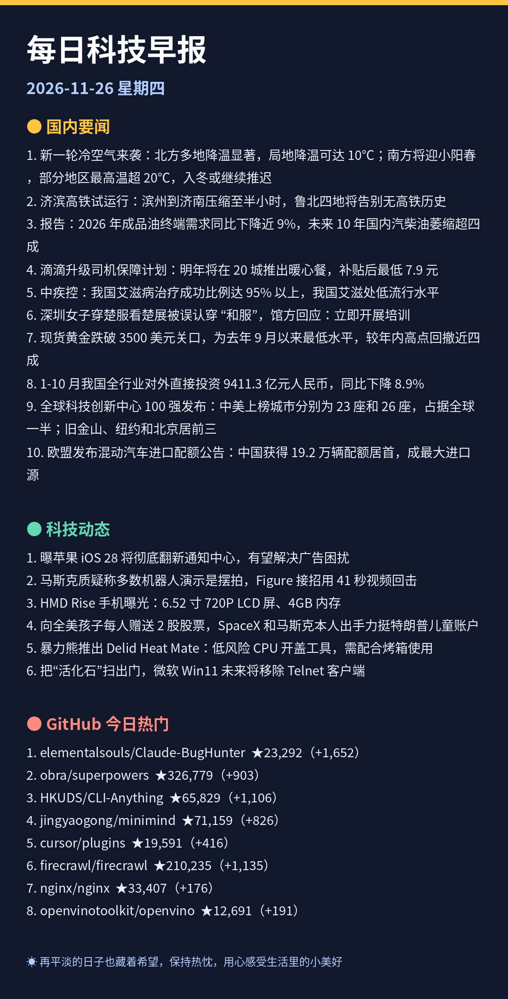

# 每日科技早报 ☀️

每天早上一份：国内要闻 + 科技动态 + GitHub 今日热门，自动抓取、自动生成，适合转发。

---

# 每日科技早报 · 2026-11-26 星期四

## 📰 国内要闻

1. 新一轮冷空气来袭：北方多地降温显著，局地降温可达 10℃；南方将迎小阳春，部分地区最高温超 20℃，入冬或继续推迟
2. 济滨高铁试运行：滨州到济南压缩至半小时，鲁北四地将告别无高铁历史
3. 报告：2026 年成品油终端需求同比下降近 9%，未来 10 年国内汽柴油萎缩超四成
4. 滴滴升级司机保障计划：明年将在 20 城推出暖心餐，补贴后最低 7.9 元
5. 中疾控：我国艾滋病治疗成功比例达 95% 以上，我国艾滋处低流行水平
6. 深圳女子穿楚服看楚展被误认穿 “和服”，馆方回应：立即开展培训
7. 现货黄金跌破 3500 美元关口，为去年 9 月以来最低水平，较年内高点回撤近四成
8. 1-10 月我国全行业对外直接投资 9411.3 亿元人民币，同比下降 8.9%
9. 全球科技创新中心 100 强发布：中美上榜城市分别为 23 座和 26 座，占据全球一半；旧金山、纽约和北京居前三
10. 欧盟发布混动汽车进口配额公告：中国获得 19.2 万辆配额居首，成最大进口源
11. 美国贸易调查后提议对多国加征关税，包括欧盟、日本、韩国等
12. 菲律宾参议员建议每人 “自愿” 捐款 17 万比索帮国家还债引众怒
13. 韩国今年前九个月出生人口较去年同比增长 14.3%，创有记录以来最大增幅
14. 美国 10 月 PCE 加速升温、GDP 增长大超预期，美媒称美联储 12 月加息 25 个基点的概率超九成
15. 黄仁勋下周出席国会听证会，特朗普称必要时愿赦免黄仁勋，对美国政府入股英伟达持开放态度

来源：60 秒读懂世界

## 💻 科技动态

1. [曝苹果 iOS 28 将彻底翻新通知中心，有望解决广告困扰](https://www.ithome.com/1/032/740.htm)
2. [马斯克质疑称多数机器人演示是摆拍，Figure 接招用 41 秒视频回击](https://www.ithome.com/1/032/739.htm)
3. [HMD Rise 手机曝光：6.52 寸 720P LCD 屏、4GB 内存](https://www.ithome.com/1/032/738.htm)
4. [向全美孩子每人赠送 2 股股票，SpaceX 和马斯克本人出手力挺特朗普儿童账户](https://www.ithome.com/1/032/737.htm)
5. [暴力熊推出 Delid Heat Mate：低风险 CPU 开盖工具，需配合烤箱使用](https://www.ithome.com/1/032/736.htm)
6. [把“活化石”扫出门，微软 Win11 未来将移除 Telnet 客户端](https://www.ithome.com/1/032/734.htm)
7. [铠侠与英伟达合作，探索如何将 GPU 有效显存扩展至 PB 级](https://www.ithome.com/1/032/722.htm)
8. [消息称泰坦军团规划 24.5" 1200Hz IPS、27" 三模 QD-OLED 显示器](https://www.ithome.com/1/032/720.htm)

来源：IT之家

## 🔥 GitHub 今日热门

1. **[elementalsouls/Claude-BugHunter](https://github.com/elementalsouls/Claude-BugHunter)** — ⭐ 23,292（今日 +1,652） · Python
   A Claude Code skill bundle for bug hunting and external red-team work - 85 skills, 16 slash commands, 681 disclosed-repo…
2. **[obra/superpowers](https://github.com/obra/superpowers)** — ⭐ 326,779（今日 +903） · Shell
   An agentic skills framework software development methodology that works.
3. **[HKUDS/CLI-Anything](https://github.com/HKUDS/CLI-Anything)** — ⭐ 65,829（今日 +1,106） · Python
   "CLI-Anything: Making ALL Software Agent-Native" -- CLI-Hub: https://clianything.cc/
4. **[jingyaogong/minimind](https://github.com/jingyaogong/minimind)** — ⭐ 71,159（今日 +826） · Python
   🧠 两小时从 0 训出你的 64M 大模型。Train your own 64M LLM from scratch in 2 hours.
5. **[cursor/plugins](https://github.com/cursor/plugins)** — ⭐ 19,591（今日 +416） · TypeScript
   Cursor plugin specification and official plugins
6. **[firecrawl/firecrawl](https://github.com/firecrawl/firecrawl)** — ⭐ 210,235（今日 +1,135） · TypeScript
   Knowledge infrastructure to make your agents smarter. Search, scrape and access 550+ data providers through one API.
7. **[nginx/nginx](https://github.com/nginx/nginx)** — ⭐ 33,407（今日 +176） · C
   The official NGINX Open Source repository.
8. **[openvinotoolkit/openvino](https://github.com/openvinotoolkit/openvino)** — ⭐ 12,691（今日 +191） · C++
   OpenVINO™ is an open source toolkit for optimizing and deploying AI inference

来源：GitHub Trending

---

☀️ 再平淡的日子也藏着希望，保持热忱，用心感受生活里的小美好

---

## 📚 历史存档

- [2026-11-26](editions/2026-11-26.md)
- [2026-11-25](editions/2026-11-25.md)
- [2026-11-24](editions/2026-11-24.md)
- [2026-11-23](editions/2026-11-23.md)
- [2026-11-22](editions/2026-11-22.md)

数据来源：60 秒读懂世界、IT之家、GitHub Trending；每日自动更新。
